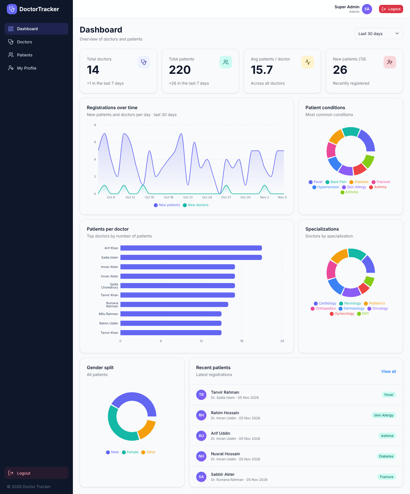
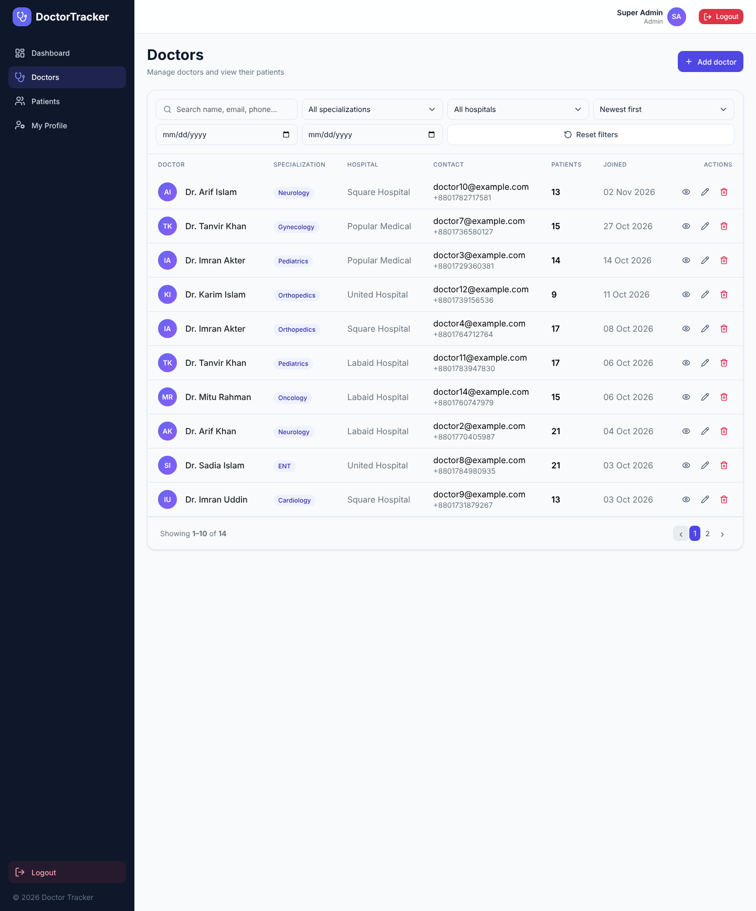
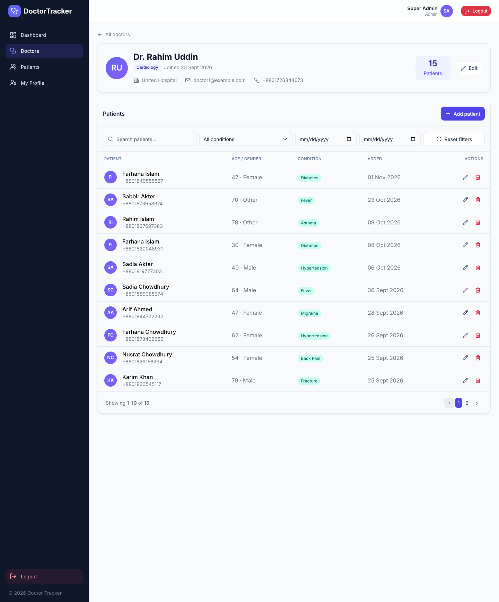
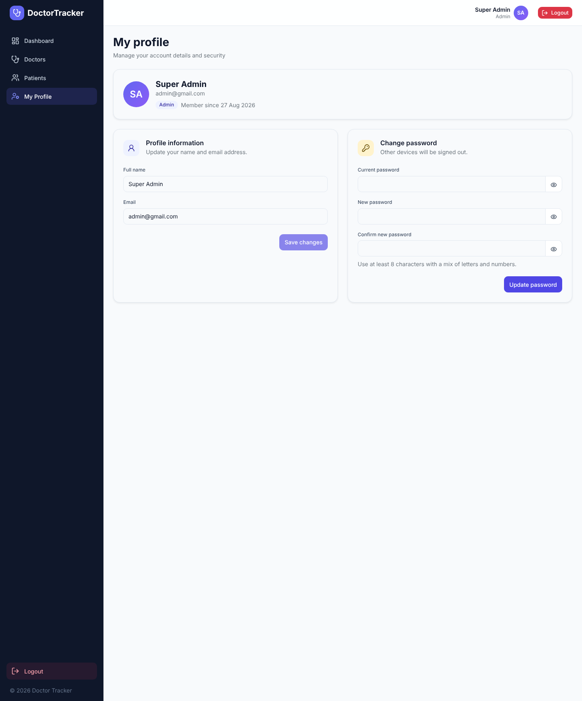
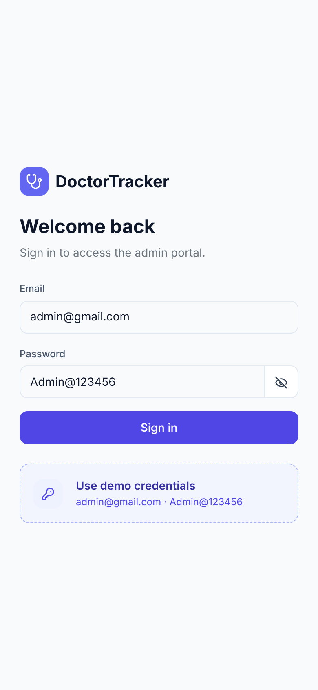
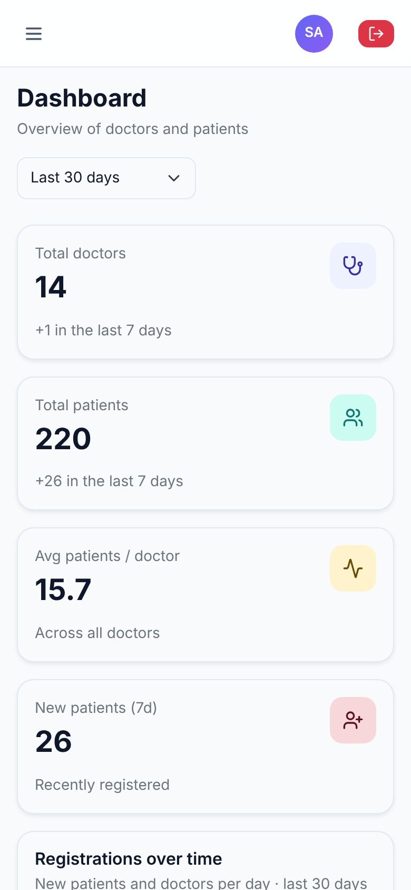
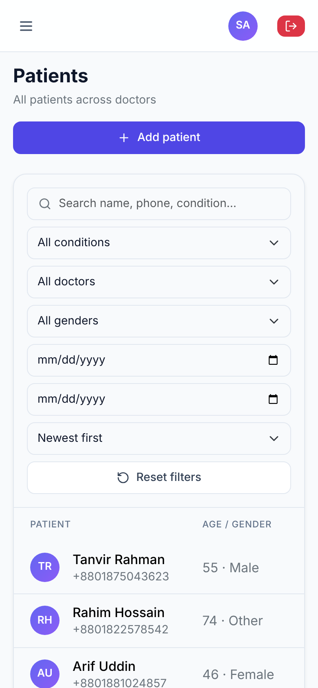
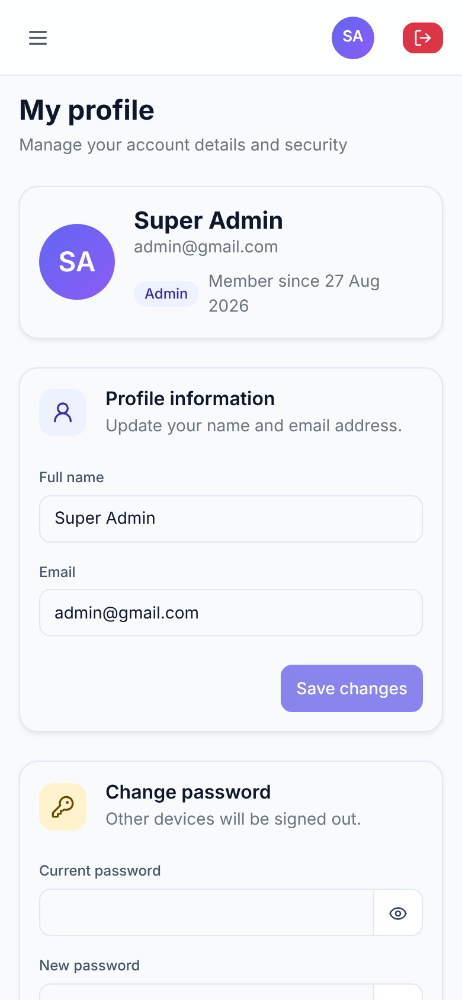

# Doctor Tracker – Backend API

## Description

Doctor Tracker API is the secure REST backend for a hospital admin portal that manages doctors and their patients. Built with Express and MongoDB, it provides JWT authentication (httpOnly cookies with refresh-token rotation), role-based authorization, doctor and patient CRUD with indexed server-side search, filtering and pagination, admin profile and password management, and aggregated analytics endpoints that power the dashboard charts. The Next.js client lives in `doctor-tracker-frontend`.

## Setup Guide

**Requirements:** Node.js 18+, MongoDB (local or Atlas).

1. Install dependencies
   ```bash
   cd doctor-tracker-backend
   npm install
   ```
2. Create the environment file from the included `.env.example`
   ```bash
   cp .env.example .env
   ```
   | Variable | Description |
   |---|---|
   | `PORT` | API port (default `5000`) |
   | `MONGODB_URI` | MongoDB connection string |
   | `JWT_ACCESS_SECRET`, `JWT_REFRESH_SECRET` | long random secrets: `node -e "console.log(require('crypto').randomBytes(48).toString('hex'))"` |
   | `CLIENT_URL` | allowed frontend origin(s), comma separated (CORS) |
   | `COOKIE_SAME_SITE` | `lax` locally; `none` (HTTPS) if frontend and API are on different domains |
   | `SEED_ADMIN_NAME/EMAIL/PASSWORD` | admin created by the seed script (`admin@gmail.com` / `Admin@123456`) |
3. Seed the database (admin user, 14 doctors, 220 patients, indexes)
   ```bash
   npm run seed          # use `npm run seed:fresh` to wipe doctors/patients first
   ```
4. Start the server
   ```bash
   npm run dev           # http://localhost:5000/api   (npm start for production)
   ```
5. Check `GET http://localhost:5000/api/health`, then log in with the seeded admin.

## System Architecture

```
Next.js client ──REST/JSON, httpOnly cookies──▶ Express API ──Mongoose──▶ MongoDB

request ─▶ helmet · cors · rate-limit ─▶ protect (JWT) ─▶ restrictTo(role) ─▶ validate (zod) ─▶ controller ─▶ model
                                                                                   └─▶ errorHandler (uniform JSON errors)
```

```
src/
├── server.js, app.js        # boot, middleware stack, graceful shutdown
├── config/                  # env validation, mongoose connection
├── models/                  # User, Doctor, Patient (+ indexes)
├── routes/                  # URL → middleware → controller
├── controllers/             # auth, doctor, patient, dashboard logic
├── validators/              # zod schemas for params, query, body
├── middleware/              # auth (protect/restrictTo), validate, errorHandler, rateLimiters
├── utils/                   # ApiError, asyncHandler, tokens, helpers
└── seed/seed.js
```

**Request flow:** every route except `/health`, `/auth/login`, `/auth/refresh`, `/auth/logout` passes through `protect`, which accepts the httpOnly `accessToken` cookie or a `Bearer` header. Input is validated with zod before reaching controllers, and all failures are normalised to `{ success:false, message, details? }`.

### API Reference (prefix `/api`)

| Method | Endpoint | Description | Access |
|---|---|---|---|
| POST | `/auth/login` | Login, sets cookies, returns `accessToken` | public |
| POST | `/auth/refresh` | Rotate tokens via refresh cookie | public |
| POST | `/auth/logout` | Revoke refresh token, clear cookies | public |
| GET | `/auth/me` | Current user | auth |
| PUT | `/auth/profile` | Update own `name` / `email` | auth |
| PUT | `/auth/password` | Change own password (`currentPassword`, `newPassword`); other sessions revoked | auth |
| POST | `/auth/register` | Create admin/staff user | admin |
| GET | `/doctors` | List: `page, limit, search, specialization, hospital, from, to, sortBy, order` | auth |
| POST | `/doctors` | Create doctor | auth |
| GET | `/doctors/filters` | Distinct specializations and hospitals | auth |
| GET / PUT | `/doctors/:id` | Get (with `patientsCount`) / update | auth |
| DELETE | `/doctors/:id` | Delete doctor and their patients | admin |
| GET / POST | `/doctors/:id/patients` | List / add patient under a doctor | auth |
| DELETE | `/doctors/:id/patients/:patientId` | Remove patient from doctor | auth |
| GET / POST | `/patients` | List (`search, doctor, condition, gender, from, to, …`) / create | auth |
| GET | `/patients/conditions` | Distinct conditions | auth |
| GET / PUT / DELETE | `/patients/:id` | Get / edit / delete | auth |
| GET | `/dashboard/stats?days=30&top=10` | Totals, patients per doctor, daily timelines, distributions, recent patients | auth |

`from` / `to` are ISO dates filtering on `createdAt`. Success: `{ success:true, data, meta? }`.

## Technical Decisions

### 1. JWT in httpOnly cookies with hashed, rotating refresh tokens
A 15-minute access token and a 7-day refresh token are issued as httpOnly cookies, so scripts (and XSS) cannot read them. The refresh token is stored only as a SHA-256 hash on the user document and is rotated on every refresh; a stolen or replayed old token no longer matches and is rejected. Logout and password change clear or rotate the stored hash, which signs out other devices. A non-sensitive `session` marker cookie is set alongside, so the Next.js middleware can redirect anonymous visitors before rendering; it grants no access by itself. A `Bearer` header is also accepted so Postman and other API clients work. Trade-off: one active refresh session per user, in exchange for simple, revocable server-side control without a separate session store.

### 2. Index-backed queries and single-round-trip aggregations
Compound indexes match the real access patterns (`doctor+createdAt`, `specialization+createdAt`, `hospital+createdAt`, `condition+createdAt`, …) so filter, sort and pagination avoid collection scans. The doctor list uses one `$facet` aggregation that returns the page and the total together, and runs the per-doctor patient-count `$lookup` *after* `$limit`, so it only touches one page of documents. Responses are gzip-compressed (`compression`). Dashboard analytics run in parallel (`Promise.all`) as `$group` aggregations, with gaps in daily timelines filled in code. Search uses escaped, case-insensitive regex for partial matching; for very large collections the next step is a MongoDB text index or Atlas Search.

## Visual Evidence

This is an API-only service, so the visual evidence is the client UI it powers. Screenshots (sample data: 14 doctors, 220 patients):

### Desktop

| Dashboard (`/dashboard/stats`) | Doctors (`/doctors`) |
|---|---|
|  |  |

| Doctor's patients (`/doctors/:id/patients`) | Profile and password (`/auth/profile`, `/auth/password`) |
|---|---|
|  |  |

### Mobile

| Login | Dashboard | Patients | Profile |
|---|---|---|---|
|  |  |  |  |

## Deployment

Use MongoDB Atlas for `MONGODB_URI`, set `NODE_ENV=production` (disables auto-index build and hides stack traces), strong JWT secrets, and `CLIENT_URL` to the frontend origin. In production run `node -e "require('./src/seed/seed.js')"` once (or `npm run seed`) to create the admin and sync indexes. If the frontend uses its `/api` proxy (recommended), keep `COOKIE_SAME_SITE=lax`.
